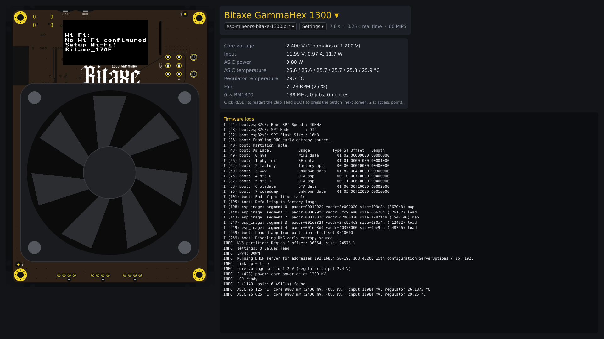
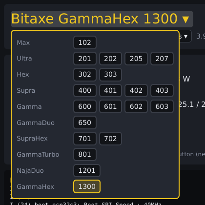
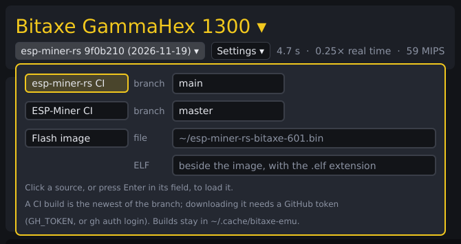

# bitaxe-emu-rs

A Bitaxe emulator. The ESP32-S3 of the board runs the miner firmware, and the
rest of the board is modelled around it. A window shows the front of the board
with its display, buttons and fans, next to the board telemetry and the firmware
logs.



| Board menu | Firmware menu |
|---|---|
|  |  |

The workspace has two crates:

- [`esp32s3-emu`](esp32s3-emu/README.md): the ESP32-S3. Its processor is
  [rax](https://github.com/Georges760/rax/tree/feat/xtensa-esp32s3)'s Xtensa LX7
  interpreter; the crate models the memory map, the boot from the internal ROM
  and the peripherals, and has a headless runner, `esp32s3-run`. Nothing in it is
  specific to the Bitaxe.
- `bitaxe-emu` (the root crate): the boards around the chip and the window.

## Boards

Every board number the [esp-miner-rs](https://github.com/bitaxeorg/esp-miner-rs)
firmware builds for:

| Board | Number | Chips | Core regulator | Fans and temperatures | Display |
|---|---|---|---|---|---|
| Max | 102 | 1 × BM1397 | TPS40305 + DS4432 DAC, INA260, VCore on ADC | EMC2101, chip diode | OLED |
| Ultra | 201, 202, 205 | 1 × BM1366 | TPS40305 + DS4432 DAC, INA260, VCore on ADC | EMC2101, internal sensor | OLED |
| Ultra | 207 | 1 × BM1366 | TPS546D24A | EMC2101, chip diode | OLED |
| Hex | 302, 303 | 6 × BM1366, 3 domains | TPS546D24A, 12 V | EMC2302 (2 fans), 2 × TMP1075 | OLED |
| Supra | 400, 401 | 1 × BM1368 | TPS40305 + DS4432 DAC, INA260, VCore on ADC | EMC2101, internal sensor | OLED |
| Supra | 402, 403 | 1 × BM1368 | TPS546D24A | EMC2101, chip diode | OLED |
| Gamma | 600 to 603 | 1 × BM1370 | TPS546D24A | EMC2101, chip diode | OLED |
| GammaDuo | 650 | 2 × BM1370 | TPS546D24A | EMC2101, chip diode | OLED |
| SupraHex | 701, 702 | 6 × BM1368, 3 domains | TPS546D24A, 12 V | EMC2302 (2 fans), 2 × TMP1075 | OLED |
| GammaTurbo | 801 | 2 × BM1370 | TPS546D24A, 12 V, 2 phases | EMC2103, 2 chip diodes | OLED |
| NajaDuo | 1201 | 2 × BM1373, 2 domains | TPS546D24A, 12 V, 2 phases, chip power enable | EMC2103, 2 chip diodes | ST7789 LCD |
| GammaHex | 1300 | 6 × BM1370, 2 domains | TPS546D24A, 12 V, 4 phases, chip power enable | EMC2103, 2 chip diodes | ST7789 LCD |

The models:

| Part | Model |
|---|---|
| ESP32-S3 | `esp32s3-emu`: boots from its internal ROM through the 2nd-stage bootloader to the application, from the flash image |
| SSD1306 0.91" OLED, 128×32 (I2C 0x3C) | display RAM, addressing modes, remap, scan direction, start line, offset, invert |
| ST7789 1.9" LCD, 320×170 (8-bit parallel bus on LCD_CAM, with DMA) | frame memory, address window, MADCTL access order, RGB565 byte order, inversion, sleep and display on/off; reset, panel power and backlight lines |
| TPS546D24A (PMBus 0x24) | commands read back; IC_DEVICE_ID; VIN, VOUT, IOUT and temperature telemetry; output on/off |
| TPS40305 + DS4432 (0x48) + INA260 (0x40) | the output voltage from the DAC current into the feedback divider, PWR_EN on GPIO10; input voltage, current and power; the output voltage on ADC1 (GPIO2) |
| EMC2101 (0x4C), EMC2103 (0x2E), EMC2302 (0x2F), TMP1075 (0x4A, 0x4B) | register files; internal, diode and board temperatures; fan tachometers from the fan drives |
| BM13xx chain on UART1, NRST on GPIO1 | CHIP_ID enumeration, address assignment along the chain, registers, PLL frequency, version-rolling response format, jobs; nonces searched on the host within a small hash budget |
| Power and heat | chip power from voltage (per domain), frequency and activity; heatsinks with a fan-dependent thermal resistance; regulator and board temperatures; input power |
| BOOT and RESET buttons | GPIO0 and chip enable, clickable on the board picture |

## Running

Start `bitaxe-emu` without arguments, from a terminal or from the desktop's
application menu (the Nix package installs a launcher). The window opens on the
board and firmware chosen last, the Gamma 601 with the latest esp-miner-rs CI
build at first, and its menus change everything while it runs:

| Menu | Choices |
|---|---|
| The board name | every board number, by family; the chip restarts on the new board |
| The firmware | the newest esp-miner-rs CI build for the board, or the newest ESP-Miner CI factory image, each of a branch; the board's factory image of an ESP-Miner release (the newest by default), which holds the board settings and needs no token; or a flash image file, with the ELF of the application for its defmt logs (by default the image's path with `.elf`) |
| Settings | the ESP32-S3 ROM image and the MAC address (the chip restarts with them); whether the flash is written back to its file when the emulator stops; saving the display's image as PNG |

Click RESET to restart the chip. BOOT is held as long as the mouse button is.
The choices are kept in `~/.config/bitaxe-emu/choice`.

### CI builds

The emulator looks up the newest run of the firmware's CI on the branch that
holds the build (`esp-miner-rs-bitaxe-<board>` for esp-miner-rs, `esp-miner-factory.bin`
for ESP-Miner), downloads it once into `~/.cache/bitaxe-emu`, and uses the cache
when GitHub cannot be reached. GitHub serves CI artifacts to authenticated
clients only: the token comes from `GH_TOKEN`, `GITHUB_TOKEN`, or the GitHub CLI
(`gh auth login`).

The esp-miner-rs CI keeps the application image and its ELF. The emulator adds
the ESP32-S3 2nd-stage bootloader (`assets/esp32s3-bootloader.bin`, the one
`espflash save-image --merge --flash-size 16mb` writes) and the partition table
of the run's `firmware/partitions.csv` to make the flash.

An ESP-Miner release brings a factory image per board (`esp-miner-factory-<board>-<tag>.bin`,
with the board settings in NVS); it is downloaded the same way, without a token.

### Options

Every option has an environment variable, and the window's menus change them
while it runs (except the run modes, `--headless` and `--display-png` after it).
An option or its variable overrides the choice kept from the window.

| Option | Variable | Window |
|---|---|---|
| `--board <number or family>` (`601`, `gamma`...; by default the number in the flash or ELF file name, `...bitaxe-601...`) | `BITAXE_EMU_BOARD` | board menu |
| `--flash <image>` (bootloader, partition table and application, `espflash save-image --merge`) | `BITAXE_EMU_FLASH` | firmware menu, Flash image |
| `--elf <file>` | `BITAXE_EMU_ELF` | firmware menu, ELF |
| `--firmware esp-miner-rs\|esp-miner\|esp-miner-release` (the newest CI build, or an ESP-Miner release) | `BITAXE_EMU_FIRMWARE` | firmware menu |
| `--branch <name>` (`main` for esp-miner-rs, `master` for ESP-Miner; for a release, its tag, `latest` by default) | `BITAXE_EMU_BRANCH` | firmware menu, branch or version |
| `--rom <file>` (by default the image of the build: `ESP32S3_ROM` at build time, which the Nix package sets, else `../upstream/qemu-espressif/pc-bios/esp32s3_rev0_rom.bin`) | `BITAXE_EMU_ROM` | Settings |
| `--mac <address>` (default `7c:df:a1:0b:17:ae`) | `BITAXE_EMU_MAC` | Settings |
| `--persist [true\|false]` (write the flash back to its file when the emulator stops, keeping the settings the firmware saved) | `BITAXE_EMU_PERSIST` | Settings |
| `--display-png <file>` (where to save the display's image) | `BITAXE_EMU_DISPLAY_PNG` | Settings, Save as PNG |
| `--headless <seconds>` (run without a window, print the logs and the OLED as text) | `BITAXE_EMU_HEADLESS` | — |

```bash
# A local build of esp-miner-rs, headless for 10 s:
espflash save-image --chip esp32s3 --merge --flash-size 16mb \
  --partition-table partitions.csv esp-miner-rs esp-miner-rs-bitaxe-601.bin
bitaxe-emu --flash esp-miner-rs-bitaxe-601.bin --elf esp-miner-rs --headless 10
# The newest esp-miner-rs CI build for the GammaHex:
BITAXE_EMU_FIRMWARE=esp-miner-rs BITAXE_EMU_BOARD=1300 bitaxe-emu
```

Debugging aids, all optional: `BITAXE_EMU_SCRIPT="2.0:boot_down,4.6:boot_up,6:reset"`
presses buttons at given times in headless runs, `BITAXE_EMU_MMIO_LOG=1` prints
the last peripheral accesses, `BITAXE_EMU_PROFILE=1` samples the call chains,
`ESP32S3_I2C_TRACE=1` traces the I2C command lists,
`BITAXE_EMU_DUMP="0x40370000:0x70000:iram.bin,..."` saves memory ranges at the
end of a headless run, and `BITAXE_EMU_CONSOLE_DUMP=<prefix>` appends the raw
UART0 and USB-Serial-JTAG output to `<prefix>.uart` and `<prefix>.usb`.

### Building

The development environment is the flake (the nightly Rust of
`rust-toolchain.toml`, which BLIT needs, the Wayland libraries, the fonts and
`espflash`): `direnv allow` (the local `.envrc` holds `use flake`), or prefix
commands with `nix develop -c`. Then `cargo build --release` builds
`target/release/bitaxe-emu`.

## Installing with Nix

The flake also packages the emulator: `nix build` gives `result/bin/bitaxe-emu`
and `result/bin/esp32s3-run`, and `nix run github:bitaxeorg/bitaxe-emu-rs` runs
it. The package fetches the ESP32-S3 ROM image, so `--rom` is not needed, and
installs a desktop entry with its icon ("Bitaxe Emulator"). The window's title is
"Bitaxe emulator"; it sets no Wayland app_id, so window rules match the title
(Hyprland: `windowrule = float on, match:title ^(Bitaxe emulator)$`).

On NixOS, with the system configuration in a flake:

```nix
{
  inputs = {
    nixpkgs.url = "github:NixOS/nixpkgs/nixos-unstable";
    bitaxe-emu = {
      url = "github:bitaxeorg/bitaxe-emu-rs";
      inputs.nixpkgs.follows = "nixpkgs";
    };
  };

  outputs = { nixpkgs, bitaxe-emu, ... }: {
    nixosConfigurations.my-machine = nixpkgs.lib.nixosSystem {
      system = "x86_64-linux";
      modules = [
        ./configuration.nix
        bitaxe-emu.nixosModules.default
        { programs.bitaxe-emu.enable = true; }
      ];
    };
  };
}
```

Or, without the module: `nixpkgs.overlays = [ bitaxe-emu.overlays.default ];`
then `environment.systemPackages = [ pkgs.bitaxe-emu ];` (the same overlay
works in Home Manager's `home.packages`). Both build with the system's nixpkgs.

rax is fetched from GitHub at the revision pinned in `nix/rax.nix`; after a
change of rax, push it, put the new commit in `rev`, empty `hash`, and
`nix build` prints the hash to write there. A change of the BLIT revision in `Cargo.toml` needs the same for
its hash in `nix/package.nix`.

## Limits

- WiFi is not emulated: the radio's registers answer the calibration polls, so
  the firmware starts its access point, but no packet goes in or out. Without a
  network there is no pool and no job, so the chips stay idle.
- Hashing on the host is far slower than the chips: at the usual ticket
  difficulties a nonce is rare.
- The interpreter runs at about 60-80 MIPS: the firmware runs below real time
  while it is busy, and the window shows the speed.
- The power, thermal and fan figures come from a simple model, not from
  measurements of each board.
- ESP-Miner runs (both cores, the octal PSRAM, the display, the regulator, the
  fans and the ASIC chain) from its release images; its CI image holds no board
  settings. The emulated eFuses carry no ADC calibration, so ESP-Miner logs ADC
  calibration errors (every 100 ms on the DAC boards, which read the core
  voltage on the ADC); the TPS546 model does not answer MFR_ID, MFR_MODEL or
  MFR_REVISION.

## Licenses

The code is MIT or Apache-2.0. The board pictures in `assets/` are rendered from
the boards' KiCad projects by `assets/render-boards.sh`:

| Picture | KiCad project (revision) | Licence |
|---|---|---|
| `gamma-front.png` (600 to 603, and 650, which has no published design) | bitaxeorg/bitaxeGamma (601) | CERN-OHL-S-2.0 |
| `max-front.png` | bitaxeorg/bitaxeMax (v2.2) | CERN-OHL-S-2.0 |
| `ultra-205-front.png` (201, 202, 205) | bitaxeorg/bitaxeUltra (205) | CERN-OHL-S-2.0 |
| `ultra-207-front.png` | bitaxeorg/bitaxeUltra (207) | GPL-3.0 |
| `supra-401-front.png` (400, 401), `supra-403-front.png` (402, 403) | bitaxeorg/bitaxeSupra (401, 403) | CERN-OHL-S-2.0 |
| `hex-front.png` (302, 303) | bitaxeorg/ultraHex (303) | MIT |
| `suprahex-front.png` (701, 702) | bitaxeorg/supraHex (701) | GPL-3.0 |
| `gammaturbo-front.png` | bitaxeorg/BitaxeGT (800x) | CERN-OHL-S-2.0 |
| `najaduo-front.png` | bitaxeorg/naja-duo (1201) | CERN-OHL-S-2.0 |
| `gammahex-front.png` | bitaxeorg/BitaxeGammaHex (1300) | CERN-OHL-S-2.0 |

The pictures are built into the binary. Where a design has no display module or
fan in its 3D models, the window places them where they mount.

`assets/esp32s3-bootloader.bin` is the ESP-IDF 2nd-stage bootloader for the
ESP32-S3 that espflash 4.6.0 writes with `--flash-size 16mb` (Apache-2.0); it is
built into the binary too.
